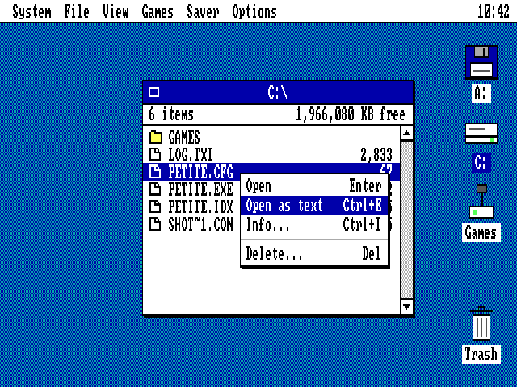
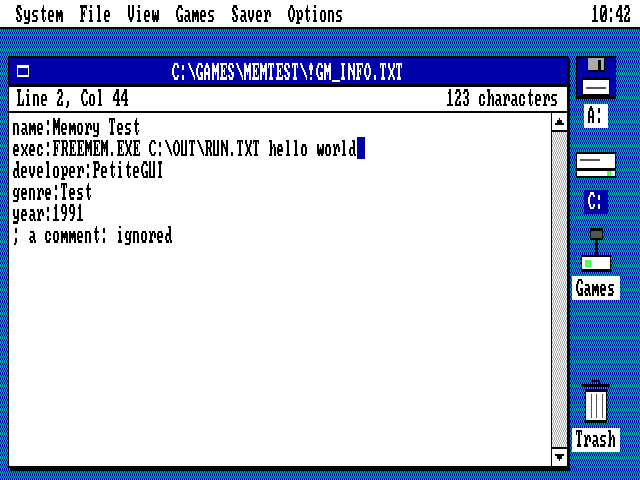
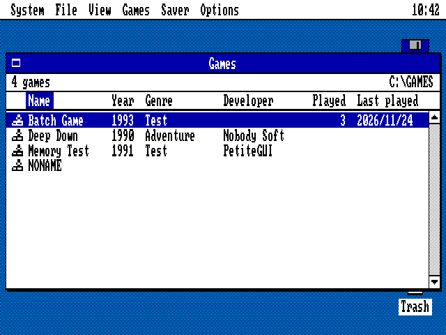
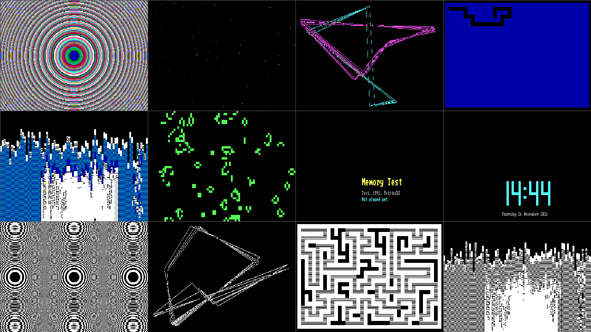

# PetiteGUI

<p>
  <a href="https://github.com/MaverickUK/PetiteGUI/actions/workflows/build.yml"></a>
  <a href="https://github.com/MaverickUK/PetiteGUI/actions/workflows/release.yml"></a>
  <a href="https://github.com/MaverickUK/PetiteGUI/releases"></a>
  <a href="https://semver.org"></a>
  <a href="CHANGELOG.md"></a>
  <a href="LICENSE"></a>
</p>

A small desktop for CGA and EGA PCs: a menu bar, windows, icons, alerts and the mouse, for any 8088 or later. It lists your games from [GameMinder](https://github.com/MaverickUK/GameMinder)'s metadata and runs them with itself swapped out of memory.

 
 

**Status:** 0.5.0: the basics, real folders, a text editor, GameMinder's games and screensavers. It runs in DOSBox-X on an emulated CGA and EGA; it hasn't been tried on a real PC yet.

## Two looks, one desktop

| Look | Mode | Colours | Runs on |
|---|---|---|---|
| **Paper** | CGA 06h, 640×200 | Black and white, with dithered greys | Any CGA, EGA or VGA |
| **Ink** | EGA 0Eh, 640×200 | 16 | Any EGA (64 KB is enough) or VGA |

Both share the layout, the widgets and the 8×8 BIOS font; only the colour table and the video driver differ. On an EGA or VGA it starts in Ink, and **Options** switches between the two.

## What it does

- **A menu bar** with drop-down menus: click, or press and drag. Check marks, disabled items and keyboard shortcuts.
- **Windows** that move (drag the title bar), come to the front, close (the box at the left) and scroll (the arrows, or the track).
- **Your folders:** double-click A: or C: for a window on the drive, a folder to go into it, and `..` to come back up.
- **A text editor** for TXT, INI and CFG files (double-click one), or any file with **Open as text**. It saves with Ctrl+S and asks before throwing changes away.
- **Right-click menus** on files (Open, Open as text, Info, Delete) and games (Run, Run setup, Game info).
- **Alerts** with a default button. File › Delete… asks first, then deletes the file.
- **Nine screensavers** (the **Saver** menu): colour cycling, blank, a starfield, lines, a maze that builds and solves itself, the desktop melting, Life grown from the desktop, a showcase of your GameMinder games, and a clock.
- **The pointer**, drawn by the DOS mouse driver, as a squat arrow to suit the tall pixels.
- **Your games**, from GameMinder's metadata: see below.

## Games, with GameMinder

PetiteGUI reads the `!GM_INFO.TXT` file [GameMinder](https://github.com/MaverickUK/GameMinder) keeps in each game's directory, and runs games the way GameMinder does.

- **The Games window** (the joystick icon, or Games › Show games, Ctrl+G) lists every game found under `ScanPath`. Pick its columns in the Games menu: year, genre, developer, type, video, sound, memory needed, times played, last played and time played. Click a heading to sort by it. The first time it opens it scans for `!GM_INFO.TXT` files and saves what it found in `PETITE.IDX`, so later opens are instant. **Games › Rescan** looks again.
- **Run a game** with a double-click, Enter or Games › Run (Games › Run setup for its `setup:` program). It uses the game's `exec:`, `before:` and `after:`; batch files go through `COMMAND.COM`.
- **Nearly all your memory for the game:** while a game runs, PetiteGUI swaps itself out to EMS, or to a `SWAP.$$$` file if there's no EMS, leaving about 2 KB behind. In testing, a game got 581 KB with PetiteGUI swapped out, against 584 KB run straight from DOS. A game whose `memory:` won't fit gets a warning first.
- **Play stats shared with GameMinder:** each play is logged to the game's `!GM_LOG.TXT` in GameMinder's format, so GameMinder's counts and times include it.

Settings go in `PETITE.CFG`, next to `PETITE.EXE`, as `key:value` lines like GameMinder's:

```
scanpath:C:\GAMES;D:\GAMES
useems:true
playstats:true
saver:random
saverdelay:5
gamecolumns:year,genre,plays
```

`saver` is `off`, `random`, `cycle`, `blank`, `stars`, `lines`, `maze`, `melt`, `life`, `games` or `clock`; the Saver menu sets it and `saverdelay` (minutes) for you.

`scanpath` defaults to the whole of `C:\`. Swap and launch files go in `%TEMP%`, or next to `PETITE.EXE`.

## Screensavers



After a few idle minutes (the **Saver** menu: 1, 5 or 15; 5 to start with) the chosen saver runs until a key, a click or the mouse moves. They're built for the hardware: **Colour cycle** draws its rings once and then only turns the palette, so it runs as smoothly on an 8088 as on a 486; **Blank** switches the picture off at the card; **Melt** moves whole bytes; the **Game showcase** reads your GameMinder index and play logs, and never scans. **Random**, the default, picks a different one each time (never Blank).

## Quick start

1. Install [Open Watcom v2](https://github.com/open-watcom/open-watcom-v2/releases) (unpack `ow-snapshot.tar.xz` to `~/opt/openwatcom`) and [DOSBox-X](https://dosbox-x.com).
2. `make` builds `build/PETITE.EXE`.
3. `tools/run.sh` runs it on an emulated CGA, at roughly an IBM PC/XT's speed; `tools/run.sh ink` on an EGA.
4. On a real PC: copy `PETITE.EXE` over, load a mouse driver (`MOUSE.COM` or `CTMOUSE`), run `PETITE` (`/CGA` or `/EGA` to choose the look).

Keys: Enter opens (a folder, a text file, a game), Backspace goes up a folder, Ctrl+E opens as text, Ctrl+S saves, Ctrl+G games, Ctrl+I info, Del delete, Ctrl+W close, ↑ ↓ select, Esc closes a menu or alert, Ctrl+Q quits. In the editor, the keys edit the text, apart from Ctrl+G, Ctrl+O, Ctrl+S, Ctrl+W and Ctrl+Q.

Command line: `PETITE /SCAN` scans for games at once, `/LIST` prints them, `/RUN=name` runs the first whose name contains *name*, `/MEM` shows what a swap leaves for a game, and `/SET=key:value` changes a setting (`/SET=saver:clock`).

## Documents

| Page | What it covers |
|---|---|
| [docs/design.md](docs/design.md) | How it's built: the drivers, drawing, redrawing, the mouse |
| [docs/building.md](docs/building.md) | Building, the tests and the screenshots |
| [docs/style-studies.html](docs/style-studies.html) | The four looks first drawn (Paper, Arcade, Ink, Bevel), and why Paper came first |
| [CHANGELOG.md](CHANGELOG.md) | Every change, by version |

## Licence

[GPL-3.0](LICENSE).

## Credits

- **ExecWithSwap**, Copyright (c) 1988 TurboPower Software, "may be used freely as long as due credit is given": `src/swapcore.asm` is GameMinder's NASM port of it, changed for C.
- **[GameMinder](https://github.com/MaverickUK/GameMinder)** for the `!GM_INFO.TXT` and `!GM_LOG.TXT` formats and its rules for running games.
