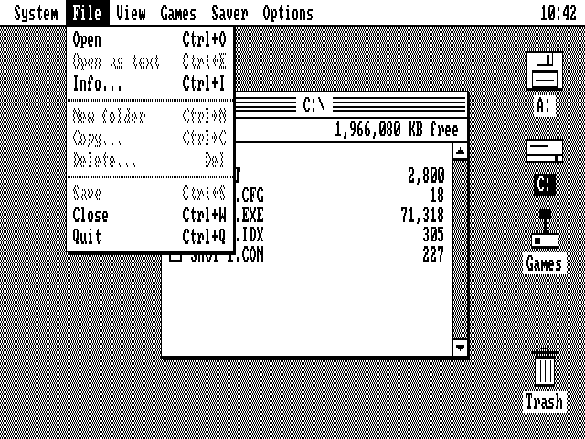
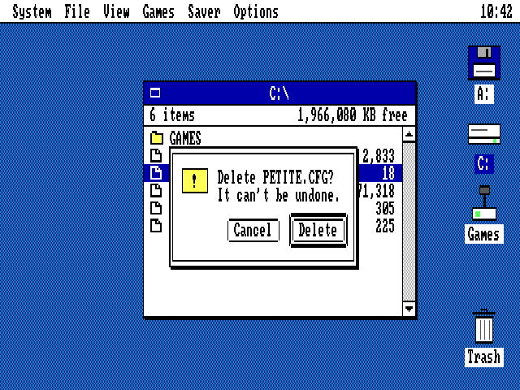

# PetiteGUI

  
  
  
  
  
  

A small desktop for CGA and EGA PCs: a menu bar, windows, icons, alerts and the mouse, in 33 KB, for any 8088 or later.

 

**Status:** 0.1.0, the basics. It runs in DOSBox-X on an emulated CGA and EGA; it hasn't been tried on a real PC yet.

## Two looks, one desktop

| Look | Mode | Colours | Runs on |
|---|---|---|---|
| **Paper** | CGA 06h, 640×200 | Black and white, with dithered greys | Any CGA, EGA or VGA |
| **Ink** | EGA 0Eh, 640×200 | 16 | Any EGA (64 KB is enough) or VGA |

Both share the layout, the widgets and the 8×8 BIOS font; only the colour table and the video driver differ. On an EGA or VGA it starts in Ink, and **Options** switches between the two.

## What it does

- **A menu bar** with drop-down menus: click, or press and drag. Check marks, disabled items and keyboard shortcuts.
- **Windows** that move (drag the title bar), come to the front, close (the box at the left) and scroll (the arrows, or the track), with a list of files to select from.
- **Desktop icons:** double-click A: or C: to open its window.
- **Alerts** with a default button: File › Delete… asks first (it only removes the line: nothing on disk is touched).
- **The pointer**, drawn by the DOS mouse driver, as a squat arrow to suit the tall pixels.

The files listed are samples, not your disks.

## Quick start

1. Install [Open Watcom v2](https://github.com/open-watcom/open-watcom-v2/releases) (unpack `ow-snapshot.tar.xz` to `~/opt/openwatcom`) and [DOSBox-X](https://dosbox-x.com).
2. `make` builds `build/PETITE.EXE`.
3. `tools/run.sh` runs it on an emulated CGA, at roughly an IBM PC/XT's speed; `tools/run.sh ink` on an EGA.
4. On a real PC: copy `PETITE.EXE` over, load a mouse driver (`MOUSE.COM` or `CTMOUSE`), run `PETITE` (`/CGA` or `/EGA` to choose the look).

Keys: Ctrl+O open, Ctrl+I info, Del delete, Ctrl+W close, ↑ ↓ select, Esc closes a menu or alert, Ctrl+Q quits.

## Documents

| Page | What it covers |
|---|---|
| [docs/design.md](docs/design.md) | How it's built: the drivers, drawing, redrawing, the mouse |
| [docs/building.md](docs/building.md) | Building, the tests and the screenshots |
| [docs/style-studies.html](docs/style-studies.html) | The four looks first drawn (Paper, Arcade, Ink, Bevel), and why Paper came first |
| [CHANGELOG.md](CHANGELOG.md) | Every change, by version |

## Licence

[GPL-3.0](LICENSE).
